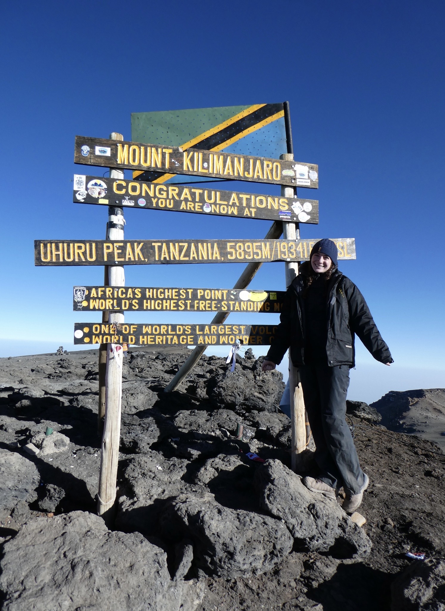
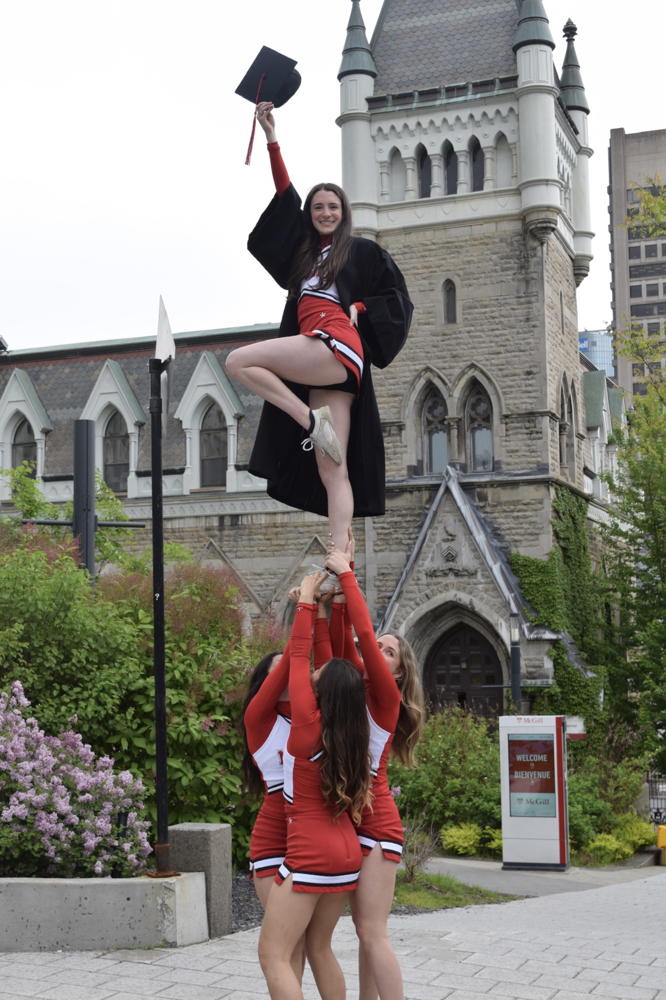
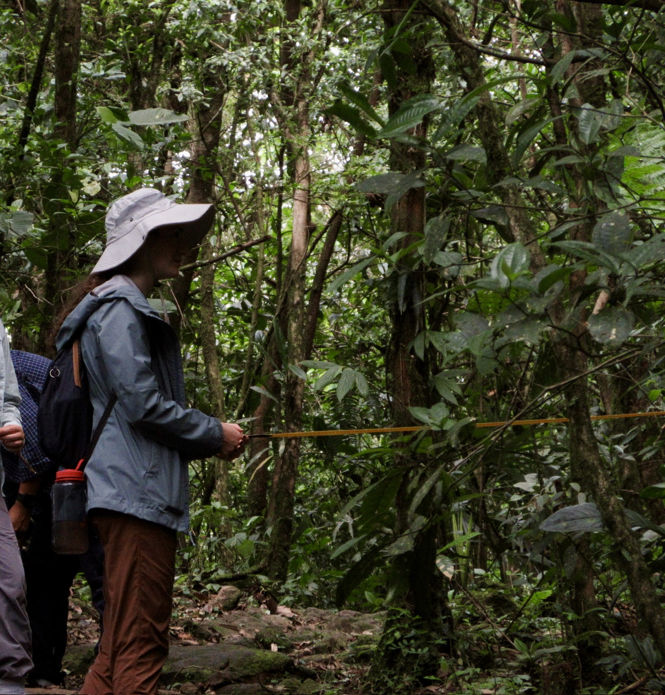
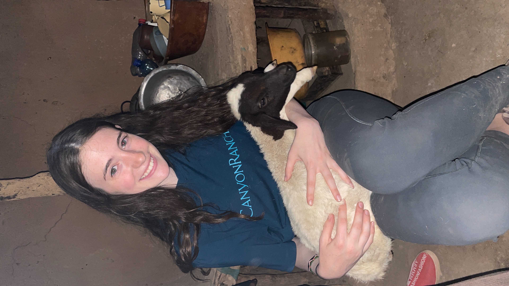
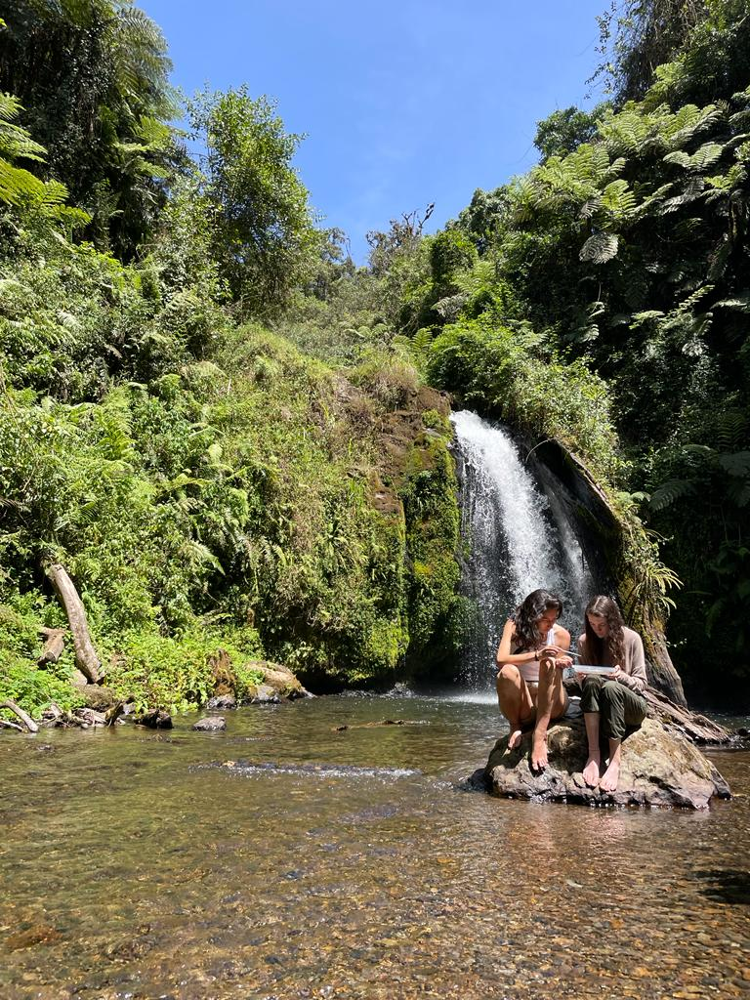
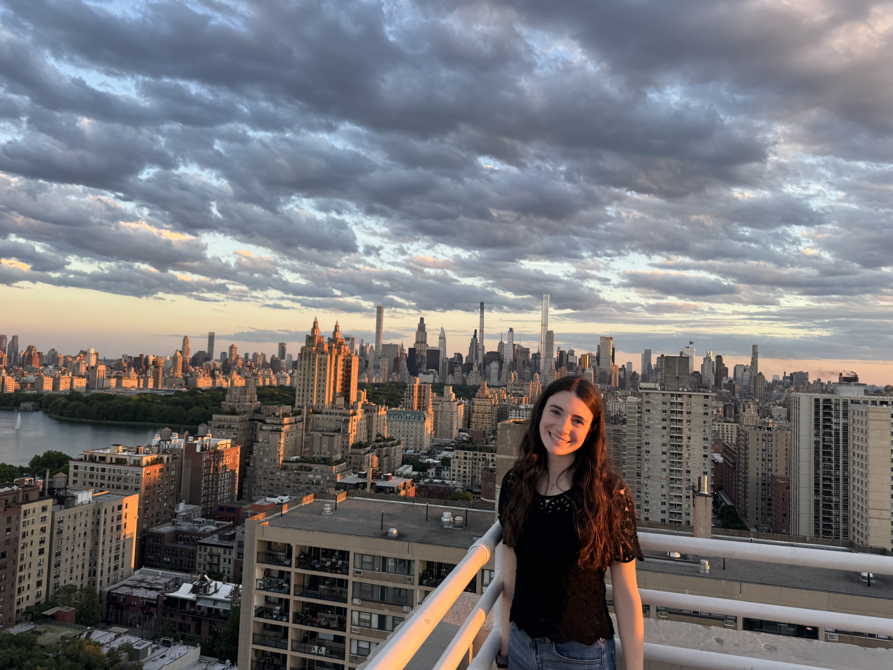
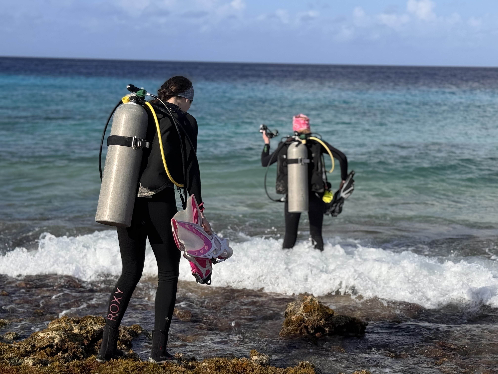
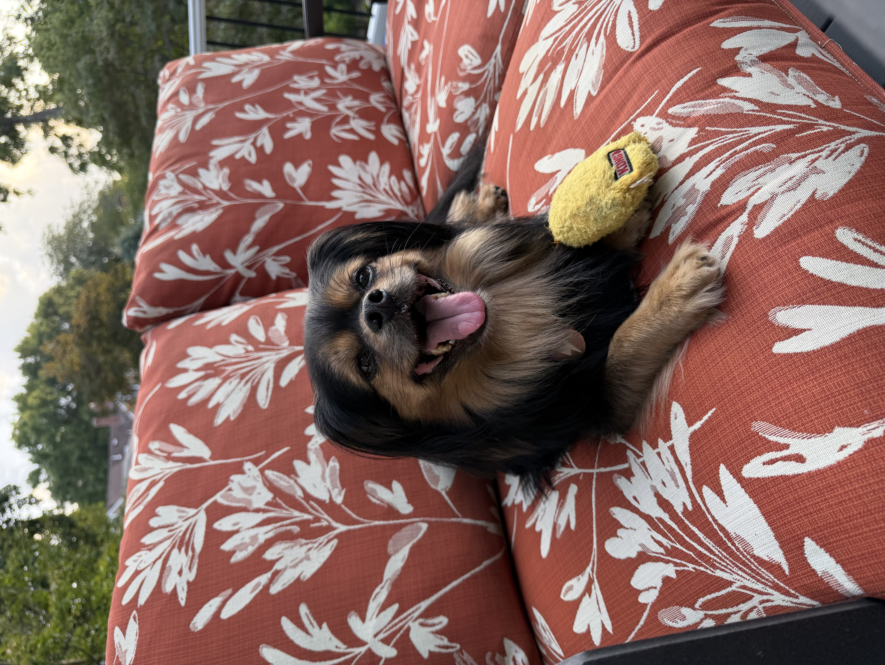

Outside of research, I have volunteered with Pothawira, a clinic, school, and orphanage in Malawi, since 2018. In 2023 I climbed Mount Kilimanjaro to raise money for the clinic's surgical center. I also cheered competitively for 12 years and coached McGill's Level 4 team, fueling my excitement about teaching. At Columbia, I am on the executive board for CIPHER, a club involved with volunteering in the Washington Heights community and spreading public health literacy. I also run the Mailman Jewish Student Association as co-president.

<small>Uhuru Peak, raising funds for Pothawira's surgical center (2023)</small>

<small>One last stunt before graduation (2025)</small>

Travelling has always been a big passion of mine. During my time at McGill, I completed two field study semesters: one in Kenya and Tanzania in 2023 and one in Panama in 2024. Though neither of these programs was necessarily health-related, they emphasized how heavily health depends on one’s surroundings. One of my favorite projects explored traditional medicine in Kenya, where I got to try chewing sticks used as toothbrushes and leaves used as deodorant. Between three months of camping, a homestay in Salto Dupi, Panama, where my bed was a wooden table, and a baboon who made off with my Swiss Army knife, I learned to adapt to whatever the field throws at you.

<small>Measuring forest density in Panama (2024)</small>

<small>Homestay in the Maasai Mara (2023)</small>

<small>Studying macroinvertebrates at Mount Kenya (2023)</small>

I am originally from the South Shore of Massachusetts, just outside Boston. I have my advanced PADI scuba diving certification, and becoming a Divemaster is one of my dreams! I have a rescue dog named Enzo who I will make sure to weave into any conversation. For anyone curious, he was found as a stray and brought into the NYCACC public shelter, and he is estimated to be about 8 years old and is a Yorkie-Pekingese mix (courtesy of the Embark DNA tests).

<small>Calling NYC home for now</small>

<small>Shore dive in Bonaire</small>

<small>Enzo :)</small>

