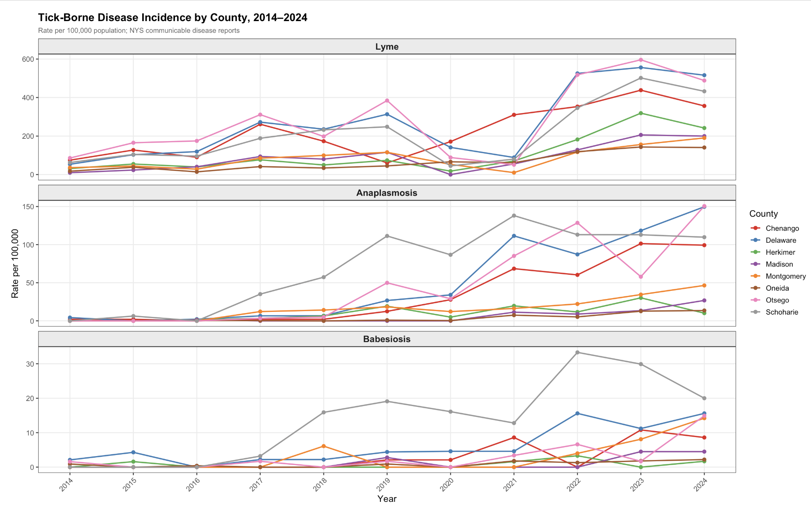
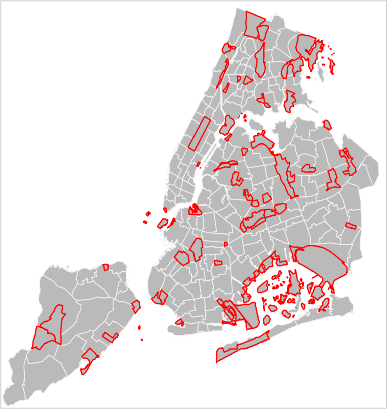

My research uses regression modeling and survey methods to study suicide prevention, gastroenterology, infectious disease, and population health.

## Suicide & Firearms

### Firearm Access and Suicide Rates Across 62 Countries

*Research Assistant · Columbia University Irving Medical Center · Oct 2025 – Oct 2026 · with Dr. Tomer Levy and Dr. Larkin McReynolds*

Ran all analyses for a study of whether civilian firearm prevalence is associated with firearm suicide rates, and whether the association differs by age and sex. Built a reproducible R pipeline linking WHO and UN data (20,000+ observations) and fit negative binomial models with cluster-robust standard errors.

**Output:** First-author oral presentation, National Research Conference for the Prevention of Firearm-Related Harms (Dec 2026). Manuscript in preparation.

### Suicide Methods Across Decades and Countries

*Research Assistant · Columbia University Irving Medical Center · Jul 2026 – Present*

Leading the statistical design of a new cross-national study of how suicide methods have changed over time.

## Clinical Research & Real-World Data

### Treatment Patterns in Eosinophilic Esophagitis

*Research Assistant · Columbia University Irving Medical Center · Jan – Aug 2026 · with Dr. Sydney Pomenti and Dr. David Katzka*

Analyzed a survey of 52 EoE experts on referral patterns, treatment failure, and diagnostic approaches in R (gtsummary), and finalized the manuscript's statistics, tables, and figures.

**Output:** Co-author, *Alimentary Pharmacology & Therapeutics* (2026). [Read the paper](https://doi.org/10.1111/apt.70951)

### Incontinence After BPH Surgery: A Real-World EHR Analysis

*Research Intern · VA Boston Research Student Summer Institute · May – Aug 2024 · in collaboration with Boston Scientific*

Led project planning, including endpoint design, and drafted statistical exhibits for an analysis of incontinence after benign prostatic hyperplasia surgery. Rates fell over time, and the project showed the limits of real-world data for judging whether symptoms had resolved.

## Infectious Disease & Antimicrobial Resistance

### Public Perceptions of Antimicrobial Resistance (Master's Thesis)

*McGill University → Columbia Mailman · May 2023 – Present · with Dr. Lysanne Campeau and Dr. Lori Lerner*

Designed and fielded a survey of 199 U.S. and Canadian adults. Linear regression showed low awareness of the AMR crisis and few protective behaviors. I'm now extending the analysis for my master's thesis.

**Output:** Poster, American Urological Association Annual Meeting (2025). Manuscript in preparation.

### Tick-Borne Disease in Rural Agricultural Counties

*Research Intern · Bassett Healthcare Network (NYCAMH) · Jun – Jul 2026 · with Dr. Amanda Roome and Dr. Thelma Mielenz*

Visualized county-level tick-borne disease incidence and tick pathogen positivity across eight New York counties in R, working around small-denominator reporting issues. Also contributed to a randomized trial of on-farm tick-control interventions.

Tick-borne disease incidence in eight upstate New York counties, 2014–2024. The year-to-year swings reflect the small populations behind each rate. Built in R (ggplot2) from public NYS Department of Health data.

**Output:** Poster, Epidemiology Master's Student Day, Columbia Mailman (Nov 2026).

## Survey Methods & Population Health

### Small-Area Population Estimation for NYC Neighborhoods

*Data Analyst Intern · NYC Department of Health · Jun – Aug 2026*

Compared raking methods in SAS for neighborhood-level demographic estimates, validated complex survey data in SAS/SUDAAN, and presented recommendations to the Survey Data and Analysis Unit.

A key challenge was non-residential areas like parks, airports, and cemeteries, whose very small populations made estimates highly variable.

Non-residential NTAs in red. Built in R (sf) from public NYC City Planning data.

### Water Access in an Informal Settlement

*Research Intern · TECHO Panamá · Jan – Apr 2024*

Designed and ran a 50-question Spanish-language survey and interviews (n = 20) on water insecurity in Nueva Luz N°2, Panama. Every respondent had water 15 or fewer days a month, and household storage covered only about a week of drinking water.

**Output:** Report and community workshop for TECHO. Oral presentation at the Smithsonian Tropical Research Institute (2024). [Read the report (McGill Panama Field Study Semester)](https://www.mcgill.ca/pfss/files/pfss/fanuele_yang_2024_watercitizenship_arraijan.pdf)

## Other Research

- **Study of student engagement in Mailman's Core curriculum** (SOLER, Columbia Mailman, 2026–present): assign participants to study groups and post engagement nudges in Canvas for an education research study.
- **Systematic review protocol on mind-body movement** (Tufts University, 2024–2025): screened 2,000 abstracts and reviewed 60 full texts. Co-author on the published protocol.
- **Mangroves and food security** (McGill honours thesis, 2024–2025): a literature review of 50+ publications, presented as a poster.
